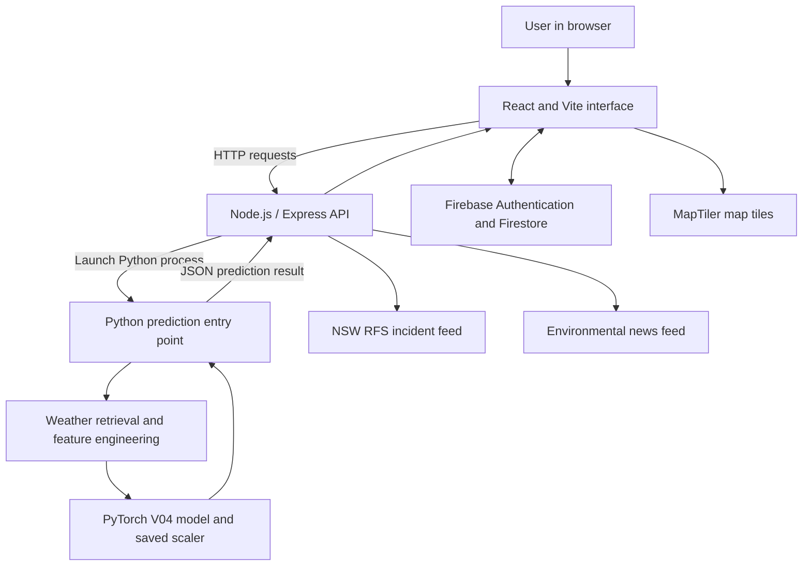

# FireScope AI

### Neural Network-Based Bushfire Risk Assessment and Environmental Intelligence Platform

**A full-stack, location-based bushfire risk exploration system combining environmental data, PyTorch inference, interactive mapping, and live incident information.**

[Live Application](https://2026s2a2.winproject.com.au/) · [Project Documentation](docs/PROJECT_OVERVIEW.md) · [User Guide](docs/USER_GUIDE.md) · [Machine Learning Design](docs/MACHINE_LEARNING.md)

> **Research and educational use only.** FireScope AI provides experimental, model-generated risk estimates. It is not an official Australian Fire Danger Rating, emergency warning, evacuation recommendation, or substitute for emergency-service advice.

---

## Platform Preview


*Interactive dashboard with location selection, environmental conditions, and access to the application's main tools.*

## Project at a Glance

| | |
|---|---|
| **Project** | FireScope AI (Bushfire AI) |
| **Type** | Full-stack software engineering and applied machine learning |
| **Primary purpose** | Explore location-specific environmental conditions and experimental bushfire risk estimates |
| **Model used by the application code** | PyTorch V04 feed-forward neural network, 15 input features |
| **Frontend** | React, Vite, JavaScript, Leaflet, MapTiler |
| **Backend** | Node.js, Express, Python inference process |
| **User accounts and records** | Firebase Authentication and Cloud Firestore |
| **External data** | Open-Meteo weather data, supplementary BOM observations, NSW RFS incident feed, environmental news |
| **Deployment architecture** | Linux VPS, Nginx reverse proxy, Node.js service managed with PM2 |
| **Development period represented in Git** | August–October 2026 |

## Why FireScope AI?

Bushfire conditions arise from interactions among temperature, humidity, wind, rainfall, seasonal patterns, and other environmental factors. Interpreting these measurements together can be difficult, particularly when they are spread across separate sources.

FireScope AI explores how a machine-learning model and an interactive web application can bring these inputs into one understandable workflow. Users select a location, retrieve relevant weather information, generate a model-based assessment, and inspect supporting context in a visual interface.

The project demonstrates **end-to-end engineering**, from environmental feature preparation and model inference to API integration, user experience, cloud-backed records, and live deployment. Its purpose is educational exploration and technical demonstration—not operational fire prediction or emergency decision-making.

## Key Capabilities

| Capability | What it provides |
|---|---|
| **Interactive dashboard** | Map-based location selection, environmental conditions, and a prediction workflow |
| **AI risk assessment** | A PyTorch-generated score and project-defined risk category for a selected location |
| **Neural network visualisation** | A visual representation of the model's layer activations for the latest prediction |
| **Risk map** | Geographic exploration and location comparison tools |
| **Fire warnings** | External NSW Rural Fire Service incident information, clearly separate from AI estimates |
| **Climate news** | Environmental news surfaced from an external feed |
| **User authentication** | Email/password and Google sign-in, email verification, and password reset flows |
| **Prediction history** | Firestore-backed history for signed-in users |
| **Saved locations** | Bookmark and revisit locations through a signed-in account |
| **Account and support pages** | Settings, About, and Contact interfaces |

Some functions depend on third-party services, authentication, network access, and available data. See [Limitations](docs/LIMITATIONS.md) and [Testing](docs/TESTING.md) for the evidence and verification boundaries.

## How It Works


1. **Select a location.** Choose a point on the map or use the available location controls.
2. **Collect environmental data.** The inference pipeline retrieves weather data relevant to the selected coordinates.
3. **Prepare model inputs.** Raw measurements are transformed into the 15-feature vector expected by the saved model and scaled using checkpoint parameters.
4. **Generate an assessment.** PyTorch produces a model score, which the application maps to a project-defined risk category and displays with environmental context.

### Application and Inference Architecture



The Express backend starts the Python prediction entry point using `child_process.spawn()`. The Python pipeline prepares the model inputs, loads the checkpoint, runs inference, and returns a structured response to the frontend. The NSW RFS feed provides **incident information**, not the model's prediction labels or scores.

For component responsibilities, endpoints, and data flow, see [System Architecture](docs/ARCHITECTURE.md).

## Neural Network


*Application visualisation of the latest inference, showing the feed-forward network and its activation patterns. The displayed example is not a validation metric.*

The application code references the **V04 PyTorch checkpoint** (`models/bushfire_model_v04.pth`) and constructs a feed-forward network with the following architecture:

```text
15 input features
       |
Linear(15, 32) + ReLU
       |
Linear(32, 16) + ReLU
       |
Linear(16, 8) + ReLU
       |
Linear(8, 1)
       |
Sigmoid at inference
       |
Project-defined score: 0–100
```

### Model Input Features

The production inference code prepares these **15 features in this order**:

| # | Feature | # | Feature | # | Feature |
|---:|---|---:|---|---:|---|
| 1 | Month | 6 | Average humidity | 11 | Days since rain |
| 2 | Day of year | 7 | Maximum wind | 12 | Temperature–humidity index |
| 3 | Season | 8 | Rain today | 13 | Temperature–wind index |
| 4 | Maximum temperature | 9 | Rain over 7 days | 14 | Dryness index |
| 5 | Minimum temperature | 10 | Rain over 30 days | 15 | Vapour pressure deficit (VPD) |

The model output is converted to a score between 0 and 100 and classified using **application-defined thresholds**:

| Score | Category |
|---:|---|
| Below 30 | Low |
| 30 to below 50 | Moderate |
| 50 to below 70 | High |
| 70 and above | Very High |

**Interpretation:** This score is **not a calibrated probability that a bushfire will occur**, and these categories are **not official Australian Fire Danger Ratings**. Independent performance metrics for the exact V04 checkpoint have not yet been verified in the project documentation.

### Experimentation and Evidence

The repository also contains experiments with alternative neural-network architectures, expanded feature sets, and Random Forest configurations. Saved evaluation results provide evidence of experimentation, but **their metrics must not be attributed to the V04 model used by the inspected application code**. The documented evaluation gaps and next steps are detailed in [Machine Learning](docs/MACHINE_LEARNING.md) and [Testing and Validation](docs/TESTING.md).

## Technology Stack

| Layer | Technologies |
|---|---|
| User interface | React, Vite, JavaScript, CSS |
| Mapping | Leaflet, MapTiler |
| API | Node.js, Express, REST/JSON |
| Machine learning | Python, PyTorch, scikit-learn |
| Data preparation | pandas, NumPy, environmental feature engineering |
| Weather and context | Open-Meteo, supplementary BOM observations |
| Incident information | NSW Rural Fire Service major-incidents feed |
| Environmental news | The Conversation Australia feed |
| Authentication and storage | Firebase Authentication, Cloud Firestore |
| Hosting and operations | Linux VPS, Nginx, PM2 |
| Source control | Git, GitHub |

## Repository Layout

```text
bushfire-ai/
├── docs/
│   ├── assets/                  # README screenshots and supporting visuals
│   ├── ARCHITECTURE.md
│   ├── DATABASE_DESIGN.md
│   ├── DEPLOYMENT.md
│   ├── DEVELOPMENT_PROCESS.md
│   ├── LIMITATIONS.md
│   ├── MACHINE_LEARNING.md
│   ├── PROJECT_OVERVIEW.md
│   ├── REQUIREMENTS.md
│   ├── ROADMAP.md
│   ├── SECURITY.md
│   ├── TESTING.md
│   └── USER_GUIDE.md
├── frontend-react/
│   ├── src/                     # React interface, pages and components
│   └── backend/server.js        # Express API and Python orchestration
├── models/                      # Saved model artifacts and experiment outputs
├── src/                         # Python inference, data and experiment code
├── README.md
└── .gitignore
```

## Running the Project

The repository contains a React/Vite application, an Express backend, and a Python prediction pipeline. Running **the complete prediction workflow** requires the Python environment, compatible dependencies, model checkpoint, and access to relevant external data services.

```bash
# From the repository root
cd frontend-react
npm install
npm run dev
```

The command above starts the **Vite development frontend**; it does not, by itself, start the Python prediction service. The Express application has its own entry point:

```bash
# From frontend-react/, in a separate terminal
npm start
```

The backend defaults to port `3015` and expects the repository-root Python interpreter at `.venv/bin/python` and prediction entry point at `src/predict_api.py`. Environment-specific configuration, frontend-to-backend routing, Firebase setup, and deployment details are covered in [Deployment and Operations](docs/DEPLOYMENT.md). **Do not assume the two commands alone constitute a fully configured installation.**

## Development and Engineering Decisions

The Git history records work beginning with a Python data pipeline and PyTorch prototype in **August 2026**, followed by a live prediction dashboard, geospatial dataset iterations, production deployment preparation, mapping improvements, and a broader set of application features in **October 2026**.

Key engineering challenges included:

- **Model-to-application integration:** Keeping inference feature order and checkpoint scaling consistent while exposing results through a web API.
- **Cross-runtime orchestration:** Coordinating a Node.js request lifecycle with a Python inference process and structured JSON output.
- **Mapping and environmental context:** Turning geographic coordinates into useful map interactions and model-ready environmental inputs.
- **Production operation:** Separating local development assumptions from reverse-proxy, process-management, and server requirements.
- **Trust and communication:** Distinguishing experimental risk estimates from official incident information, and recording what has not yet been independently validated.

For a Git-evidenced timeline, methodology, and decisions, see [Development Process](docs/DEVELOPMENT_PROCESS.md).

## Project Documentation

The documentation is organised for technical review, project assessment, and future maintenance.

| Document | Contents |
|---|---|
| [Project Overview](docs/PROJECT_OVERVIEW.md) | Motivation, scope, stakeholders, and project goals |
| [Software Requirements](docs/REQUIREMENTS.md) | Functional and non-functional requirements |
| [System Architecture](docs/ARCHITECTURE.md) | Components, API routes, integrations, and data flow |
| [Database Design](docs/DATABASE_DESIGN.md) | Firebase and Firestore data model |
| [Machine Learning](docs/MACHINE_LEARNING.md) | Model architecture, exact features, preprocessing, and evidence boundaries |
| [Development Process](docs/DEVELOPMENT_PROCESS.md) | Git-evidenced milestones and engineering decisions |
| [Testing and Validation](docs/TESTING.md) | Test cases, experimental results, and unverified areas |
| [User Guide](docs/USER_GUIDE.md) | End-user workflows and troubleshooting |
| [Deployment and Operations](docs/DEPLOYMENT.md) | Infrastructure, configuration, and operations |
| [Security and Privacy](docs/SECURITY.md) | Authentication, data protection, risks, and recommended controls |
| [Limitations and Constraints](docs/LIMITATIONS.md) | Known boundaries and reliability considerations |
| [Project Roadmap](docs/ROADMAP.md) | Prioritised improvements and future work |

## Current Status and Next Priorities

**Implemented in the inspected application code:** React dashboard, location-based prediction workflow, PyTorch V04 inference integration, interactive mapping, Firebase authentication, user history and saved locations, NSW RFS incident retrieval, environmental news integration, and supporting application pages.

**Further verification and development priorities:**

1. Independently evaluate the exact V04 checkpoint and document its predictive performance and data limitations.
2. Audit and test deployed Firestore Security Rules for per-user access control.
3. Add automated frontend and API tests, including failure cases and input validation.
4. Add explicit geographic coordinate checks, prediction process timeouts, and suitable API protections.
5. Improve monitoring, deployment reproducibility, accessibility, and incident-feed coverage.

These priorities are tracked in the [Roadmap](docs/ROADMAP.md). The presence of an implemented feature does not imply that all related tests or security controls have been independently verified.

## Safety and Responsible Use

FireScope AI is an **educational and experimental project**. Weather inputs may be incomplete or outdated, external services may be unavailable, and model outputs may be inaccurate or unsuitable for a particular location. The application does not provide comprehensive nationwide incident coverage; the integrated fire-incident source is the **NSW Rural Fire Service** feed.

**Do not use FireScope AI to make evacuation, travel, firefighting, hazard-reduction, or other safety-critical decisions.** Follow current instructions and warnings from the relevant Australian emergency-service authorities. In an immediate emergency in Australia, call **000**.

## Live Application

**FireScope AI:** [Open the deployed application](https://2026s2a2.winproject.com.au/)

## Author

**Aiigo**  
Software Engineering · Machine Learning · Infrastructure
