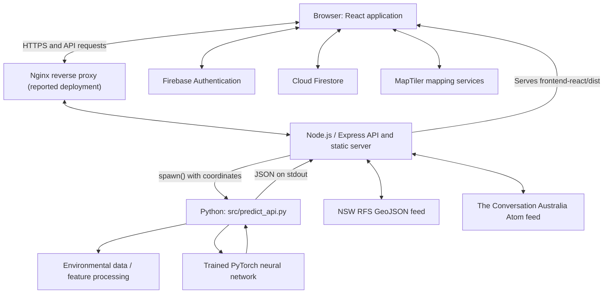
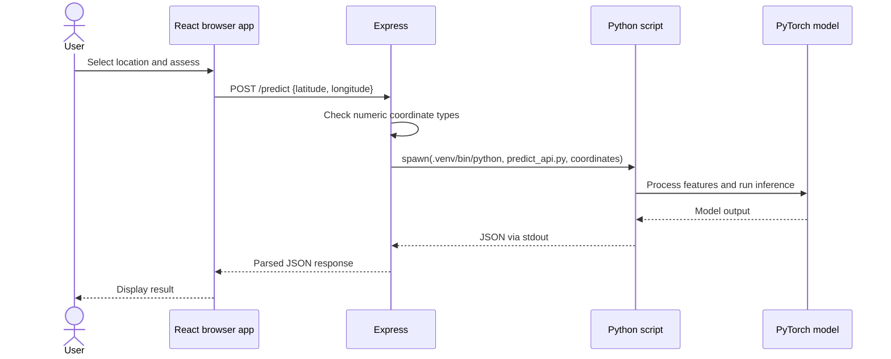

# FireScope AI — System Architecture

**Project:** FireScope AI (Bushfire AI)  
**Document type:** Technical architecture  
**Context:** ICT313 individual project

## 1. Purpose and scope

FireScope AI is an educational bushfire-risk assessment and decision-support web application. It combines a React user interface, an Express API, Python/PyTorch inference, Firebase services, interactive mapping, official NSW Rural Fire Service (RFS) incident data, and environmental news. Its machine-learning outputs are experimental and must not be interpreted as official fire warnings.

This document describes the implementation evidenced by inspected project code and the reported deployment configuration. It distinguishes verified code paths from configuration and behaviour that require testing.

## 2. High-level architecture



The diagram shows logical interactions rather than a separate host for each component. The compiled React code executes in the browser. The Python inference script is launched as a **child process** by Node.js, not exposed as an independent Flask/FastAPI server.

## 3. Components and responsibilities

| Component | Technology | Responsibility |
|---|---|---|
| Web interface | React + Vite | Navigation, location selection, predictions, maps, user-facing content |
| API and static server | Node.js + Express | API routes, Python process execution, upstream feeds, production frontend files |
| Inference pipeline | Python + PyTorch | Environmental processing and model inference |
| Identity | Firebase Authentication | Sign-in and user identity |
| User records | Cloud Firestore | Authenticated users' prediction history and other app records |
| Mapping | MapTiler SDK | Interactive map/location interfaces |
| Incident feed | NSW Rural Fire Service | Official NSW incident GeoJSON |
| News feed | The Conversation Australia | Environmental news via Atom/RSS parser |
| Production infrastructure | Linux, Nginx, PM2 (reported) | Reverse proxy and Node process management |

### Frontend structure

`frontend-react/src/App.jsx` manages the active page, selected location, loading/error state, and latest prediction. Relevant interfaces include Dashboard, Risk Map, AI Prediction, Fire Warnings, Climate News, Prediction History, Saved Locations, Settings, About, and Contact.

When the selected location changes, the application clears the previous prediction. A request identifier helps prevent an older response from overwriting the result of a newer request.

### Backend structure

`frontend-react/backend/server.js` configures Express with JSON request parsing and CORS. The server listens on `process.env.PORT` or defaults to port `3015`. It serves the compiled frontend from `frontend-react/dist`, with a catch-all route for client-side navigation.

## 4. API interface

| Method | Path | Purpose | Observed behaviour |
|---|---|---|---|
| `GET` | `/health` | Health check | Returns JSON indicating the backend is running |
| `POST` | `/predict` | Location risk assessment | Validates numeric latitude/longitude, launches Python, parses JSON result |
| `GET` | `/api/fire-incidents` | Official incident feed | Fetches and caches NSW RFS GeoJSON |
| `GET` | `/api/climate-news` | Environmental news | Parses The Conversation Australia Atom feed; cache configured |
| `GET` | Frontend paths | Web interface | Serves built frontend assets/application |

### Prediction request example

```json
{
  "latitude": -35.2809,
  "longitude": 149.1300
}
```

The prediction response is JSON produced by the Python script. The frontend uses fields such as `risk_level`, `risk_score`, `max_temp`, `avg_humidity`, `max_wind`, and `rain_last_30_days` where present. The exact complete response schema should be confirmed against `src/predict_api.py` and tested outputs.

## 5. Prediction sequence



The backend resolves the Python interpreter at `.venv/bin/python` and the script at `src/predict_api.py`, relative to the project root. It accumulates stdout and stderr, and parses stdout as JSON when the process closes successfully. A non-zero exit code returns HTTP `500` (`Prediction failed`); invalid JSON also returns HTTP `500` (`Invalid prediction response`). Non-numeric or missing coordinates return HTTP `400`.

**Design trade-off:** Direct process invocation reuses the Python model without operating a separate inference web service. However, a Python process starts for each request, which can affect latency and concurrency. The inspected route does not enforce geographic coordinate ranges or a dedicated inference timeout. These are candidates for improvement and testing.

## 6. Authentication and user data

Firebase Authentication provides the current user identity. After a successful assessment, `App.jsx` attempts to save history for authenticated users to:

`users/{uid}/predictionHistory/{documentId}`

Fields visible in the inspected write include:

| Field | Meaning |
|---|---|
| `name` | Selected location label |
| `lat`, `lng` | Coordinates |
| `risk_level`, `risk_score` | Model result |
| `max_temp`, `avg_humidity`, `max_wind`, `rain_last_30_days` | Environmental result fields |
| `createdAt` | Firestore server timestamp |

The exact schema for saved locations and account settings, as well as Firestore security rules, must be checked before being documented as verified. See [Database Design](DATABASE_DESIGN.md) and [Security](SECURITY.md).

## 7. Official incident information

`GET /api/fire-incidents` retrieves GeoJSON from the NSW RFS feed:

`https://www.rfs.nsw.gov.au/feeds/majorIncidents.json`

The backend validates that the response is a GeoJSON `FeatureCollection` containing a `features` array. Successful responses are cached **in memory for 60 seconds**, with `source` and `fetchedAt` metadata. Upstream requests have a **12-second timeout**. When the feed is unavailable or malformed, the route returns HTTP `502` rather than presenting AI predictions as official incident reports. The inspected implementation does not serve stale cached incidents after a failed refresh.

The Fire Warnings interface and header notifications use this backend data. Coverage is **NSW RFS**, not all Australian jurisdictions; ACT emergency incident integration is not established by this feed.

## 8. Climate news integration

`GET /api/climate-news` uses `rss-parser` and The Conversation Australia's environment Atom feed:

`https://theconversation.com/au/environment/articles.atom`

The inspected backend configures a **10-second parser timeout** and **15-minute cache duration**. News is supplementary content, not an input to the neural network unless separately established by inference code.

## 9. Deployment view

The project is reported as deployed at `https://2026s2a2.winproject.com.au/` on a Linux VPS, with Nginx as reverse proxy and PM2 managing the Node.js application. The React frontend is built by Vite and served by Express from `frontend-react/dist`.

The exact Nginx site configuration, PM2 process definition, environment variables, TLS settings, and deployed revision should be confirmed during the deployment documentation and production verification stages. See [Deployment](DEPLOYMENT.md).

## 10. Design considerations and risks

| Area | Current observation | Recommended verification or improvement |
|---|---|---|
| Input validation | Checks numeric coordinate types | Enforce latitude `-90..90` and longitude `-180..180` |
| Python execution | Child process per prediction | Benchmark latency/concurrency; add timeout and spawn-error handling |
| External incidents | 60-second in-memory cache | Test outage states and clearly communicate feed freshness |
| External news | 15-minute cache configured | Confirm returned response shape and failure handling |
| User records | Firestore history path confirmed | Review security rules and ownership enforcement |
| Cross-origin access | Express CORS enabled | Review allowed origins for production |
| Observability | Console error logging observed | Consider structured logs and operational monitoring |
| Model validity | Experimental neural-network output | Document dataset, metrics, generalisation limits, and calibration |

The table records implementation considerations, not verified production defects.

## 11. Architectural decisions

**React/Vite:** Supports component-based interface development and a static production build.

**Express as the integration layer:** Consolidates public API routes, external-feed access, static serving, and orchestration of the Python inference script.

**Python/PyTorch for inference:** Retains the trained model in its native ecosystem and avoids rewriting the model in JavaScript.

**Firebase for user identity and records:** Provides managed authentication and a document-oriented store for user-specific application data.

**Separation of official feeds and predictions:** Keeps NSW RFS incident information distinct from experimental machine-learning assessments, reducing the risk of implying official authority.

## 12. Related documentation

- [Project Overview](PROJECT_OVERVIEW.md)
- [Requirements](REQUIREMENTS.md)
- [Database Design](DATABASE_DESIGN.md)
- [Machine Learning](MACHINE_LEARNING.md)
- [Testing](TESTING.md)
- [Deployment](DEPLOYMENT.md)
- [Security](SECURITY.md)
- [Limitations](LIMITATIONS.md)

## 13. Conclusion

FireScope AI demonstrates an integrated full-stack application in which a browser-based React interface communicates with an Express backend that orchestrates Python/PyTorch inference. Firebase handles identity and user records, while mapping, NSW RFS incidents, and environmental news provide supporting context. The architecture is suitable for demonstrating end-to-end engineering, while performance, security, model validation, and resilience require further evidence before any higher-stakes use.
