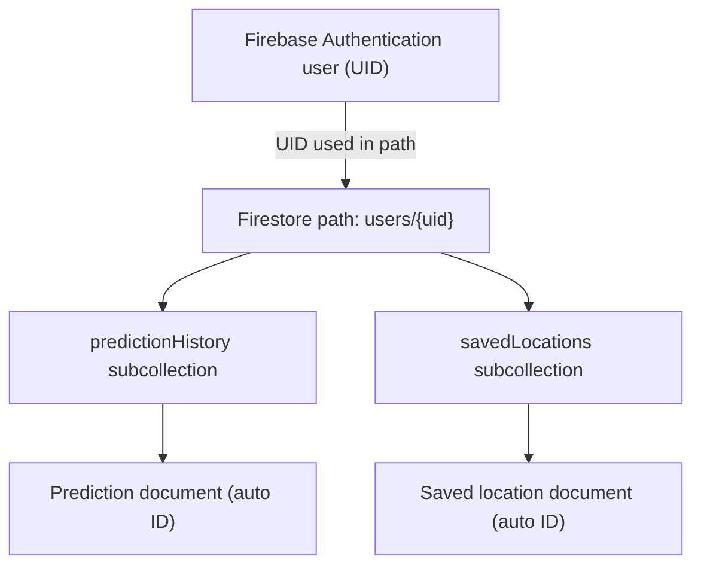

# FireScope AI — Database Design

**Project:** FireScope AI (Bushfire AI)  
**Course:** ICT313  
**Document type:** Data Model and Persistence Design  
**Evidence:** Frontend Firestore operations inspected on 19 October 2026

## 1. Purpose and scope

This document describes the **observed Cloud Firestore data model** for user prediction history and saved locations. FireScope AI uses Firebase Authentication for identity and Cloud Firestore for these persisted records. It does **not** use a relational SQL schema for the inspected features.

The schema and operations below are grounded in `frontend-react/src/App.jsx`, `frontend-react/src/pages/RiskMap.jsx`, `frontend-react/src/pages/History.jsx`, and `frontend-react/src/pages/SavedLocations.jsx`. Actual deployed Firestore security rules, indexes, and stored records have **not** been independently inspected.

## 2. Logical data model

Each signed-in user's Firebase Authentication UID is used as a path segment for two Firestore subcollections:

```text
users/
  {uid}/
    predictionHistory/
      {autoGeneratedDocumentId}
    savedLocations/
      {autoGeneratedDocumentId}
```

The `users/{uid}` path is a logical parent for the subcollections; **the code shown does not establish that a parent user-profile document exists**. Firestore subcollections can exist without a stored parent document.



This is a **document-path relationship**, not a SQL foreign-key relationship. The diagram does not imply that a parent user document is created.

## 3. Prediction history schema

**Path:** `users/{uid}/predictionHistory/{documentId}`  
**Writer:** `frontend-react/src/App.jsx`  
**Reader/deleter:** `frontend-react/src/pages/History.jsx`

| Field | Expected value/type | Source or purpose |
|---|---|---|
| `name` | String | Selected location label; defaults to `Selected location` |
| `lat` | Number | Selected latitude |
| `lng` | Number | Selected longitude |
| `risk_level` | String or null, depending on prediction response | Returned risk category |
| `risk_score` | Number or null, depending on prediction response | Returned risk score |
| `max_temp` | Number or null | Returned maximum temperature |
| `avg_humidity` | Number or null | Returned average humidity |
| `max_wind` | Number or null | Returned maximum wind |
| `rain_last_30_days` | Number or null | Returned rainfall metric |
| `createdAt` | Firestore Timestamp | Set using `serverTimestamp()` |

**Document ID:** Automatically generated by Firestore `addDoc()`; not a field explicitly written in the record.

**Example (illustrative only; not an observed database record):**

```json
{
  "name": "Selected location",
  "lat": -35.2809,
  "lng": 149.1300,
  "risk_level": "EXAMPLE_CATEGORY",
  "risk_score": 0.42,
  "max_temp": 28.0,
  "avg_humidity": 38.0,
  "max_wind": 21.0,
  "rain_last_30_days": 15.0,
  "createdAt": "<Firestore server timestamp>"
}
```

The example values are placeholders and do not represent a verified model output.

### 3.1 Creation behaviour

After a successful `/predict` response, `App.jsx` checks `auth.currentUser`. If a user is signed in, it attempts `addDoc()` to the user's `predictionHistory` subcollection. If the write fails, the application logs the failure; the prediction can still have succeeded and been displayed. **Successful prediction does not guarantee successful history persistence.**

The frontend also keeps a separate, in-memory list of recently analysed locations, limited in the inspected code to 20 entries. This local React state is **not** the same as persisted Firestore history.

### 3.2 Reading and deletion

`History.jsx` subscribes using `onSnapshot()` with `orderBy("createdAt", "desc")`, displaying newest records first. The application deletes individual records with `deleteDoc()` after user confirmation. The inspected source also includes another deletion call for history records; its full surrounding workflow should be verified before describing it as a bulk-delete feature.

## 4. Saved locations schema

**Path:** `users/{uid}/savedLocations/{documentId}`  
**Writer:** `frontend-react/src/pages/RiskMap.jsx`  
**Reader/deleter:** `frontend-react/src/pages/SavedLocations.jsx`

| Field | Expected value/type | Source or purpose |
|---|---|---|
| `name` | String | Selected location label; defaults to `Selected location` |
| `customName` | String | User-provided optional name, trimmed before saving |
| `lat` | Number | Saved latitude |
| `lng` | Number | Saved longitude |
| `createdAt` | Firestore Timestamp | Set using `serverTimestamp()` |

**Document ID:** Automatically generated by `addDoc()`.

**Example (illustrative only):**

```json
{
  "name": "Selected location",
  "customName": "Weekend trip",
  "lat": -35.2809,
  "lng": 149.1300,
  "createdAt": "<Firestore server timestamp>"
}
```

### 4.1 Duplicate prevention

Before saving a location, `RiskMap.jsx` reads the user's existing saved locations using `getDocs()`. It compares latitude and longitude after rounding both to five decimal places (`toFixed(5)`). If a match is found, it shows a message rather than adding a duplicate.

This is **client-side duplicate detection**, not a database-enforced unique constraint. Simultaneous requests or other clients could still create duplicate records.

### 4.2 Reading and deletion

`SavedLocations.jsx` uses `onSnapshot()` with `orderBy("createdAt", "desc")` to receive live updates. It deletes individual saved locations using `deleteDoc()` after user confirmation.

## 5. CRUD operation matrix

| Data set | Create | Read | Update | Delete |
|---|---|---|---|---|
| Prediction history | `addDoc()` after successful prediction, if signed in | `onSnapshot()` ordered newest first | No update operation identified in inspected code | `deleteDoc()` |
| Saved locations | `addDoc()` from Risk Map, if signed in | `getDocs()` for duplicate check; `onSnapshot()` for display | No update operation identified in inspected code | `deleteDoc()` |

No claim is made that editing or updating existing documents is implemented.

## 6. Authentication and user separation

Both features use `onAuthStateChanged()` to determine whether a user is signed in. Firestore paths include the authenticated user's UID, e.g.:

```text
users/{currentUser.uid}/predictionHistory
users/{currentUser.uid}/savedLocations
```

This **organises** data by user but **does not by itself enforce security**. Firestore Security Rules must separately prevent one authenticated user from reading or modifying another user's records. The deployed rules have not been supplied or verified, so user isolation is a **security requirement pending validation**, not a confirmed security property.

## 7. Query and indexing considerations

Both list views query their respective subcollections using `orderBy("createdAt", "desc")`. Firestore typically supports simple single-field ordering with automatic indexes, but actual indexing configuration and runtime query behaviour should be checked in the Firebase project. Additional compound filters could require composite indexes in future iterations.

The saved-location duplicate check reads the entire user's saved-location collection. This is straightforward for small collections but can become less efficient as record counts grow.

## 8. Data integrity and lifecycle

- `createdAt` is populated with a server timestamp, reducing dependence on the browser clock.
- Prediction response fields are saved with `?? null` fallbacks; some records may contain null metrics.
- Deletions are initiated from the client and must be authorised by Firestore rules.
- No database retention policy, automatic expiration, or backup procedure was verified from the supplied code.
- No parent-user document creation, transaction, or server-side schema enforcement was demonstrated in the inspected snippets.
- Firestore is schemaless: application conventions and validation are important for consistent records.

## 9. Security and privacy requirements

Before describing the database as production-secure, verify:

1. Firestore Security Rules require authentication and restrict paths to `request.auth.uid == uid`.
2. Rules validate allowed operations and, where appropriate, expected fields and types.
3. One user cannot query, edit, or delete another user's subcollection records.
4. Account deletion and data-deletion expectations are documented and tested.
5. Firebase project configuration, access privileges, and any backups are reviewed.

**Important:** These are verification tasks, **not statements that the existing rules already satisfy them**.

## 10. Suggested validation scenarios

| Test ID | Scenario | Expected result | Current evidence |
|---|---|---|---|
| DB-01 | Signed-in user completes prediction | A history document is created when Firestore write succeeds | Code path identified; runtime test pending |
| DB-02 | Signed-out user completes prediction | No user history write is attempted | Code path identified; runtime test pending |
| DB-03 | User opens Prediction History | Own records appear in descending timestamp order | Query identified; runtime test pending |
| DB-04 | User deletes a history entry | Selected record is removed after confirmation | Delete path identified; runtime test pending |
| DB-05 | User saves a new location | Saved-location document is created | Code path identified; runtime test pending |
| DB-06 | User saves same coordinates twice | Duplicate warning appears for five-decimal coordinate match | Client-side check identified; runtime test pending |
| DB-07 | User removes a saved location | Selected saved-location document is deleted | Delete path identified; runtime test pending |
| DB-08 | User A attempts to access User B's records | Access is denied by Firestore rules | Security rules and runtime test pending |

Test outcomes should be recorded in [Testing and Validation](TESTING.md); none are marked as passed without evidence.

## 11. Limitations and potential improvements

| Area | Current approach | Improvement opportunity |
|---|---|---|
| Duplicate saved locations | Client-side five-decimal comparison | Use deterministic document IDs or server-enforced uniqueness strategy |
| Data validation | Fields populated from UI and API response | Validate types, ranges, and allowed fields in Firestore rules |
| Large collections | Full read for duplicate checks | Query or index an appropriate location key |
| History persistence | Asynchronous write after prediction | Surface save status separately from prediction status |
| User-data security | UID-scoped paths in frontend | Audit and test deployed Firestore rules |
| Retention and deletion | Individual delete operations identified | Define retention, export, and account-deletion policies |

## 12. Related documentation

- [Project Overview](PROJECT_OVERVIEW.md)
- [Requirements](REQUIREMENTS.md)
- [System Architecture](ARCHITECTURE.md)
- [Security](SECURITY.md)
- [Testing](TESTING.md)
- [User Guide](USER_GUIDE.md)

## 13. Conclusion

The inspected FireScope AI implementation uses two user-scoped Firestore subcollections: **prediction history** and **saved locations**. The design supports automatic document creation, real-time list updates, and deletion, while Firebase Authentication supplies the UID used in document paths.

The principal outstanding database-design verification is the deployed **Firestore Security Rules**, followed by runtime tests of reads, writes, duplicate handling, and cross-user access restrictions.

---

## Account Deletion Data Model — October 2026

The production application now includes server-managed account deletion metadata.

### `users/{uid}`

The user document can hold deletion state metadata, including a `deletionStatus` marker used to prevent further writes during deletion.

A user parent document is not necessarily created during ordinary account usage; it can be created or updated when the deletion workflow begins.

### `accountDeletionJobs/{uid}`

A dedicated server-managed Firestore collection records account deletion processing and recovery information.

The backend uses these jobs to coordinate deletion, record progress, handle retries, and identify operations needing attention.

### Deletion behaviour

The worker recursively removes the user's Firestore subcollections, including prediction history and saved locations, before removing the Firebase Authentication account.

Deletion jobs are retained for operational tracking rather than exposed to frontend users.

### Access control

Published Firestore security rules restrict user-owned data to the authenticated owner, block writes while deletion is underway, and deny direct client access to deletion jobs.

Privileged cleanup is performed by the backend using the Firebase Admin SDK.
