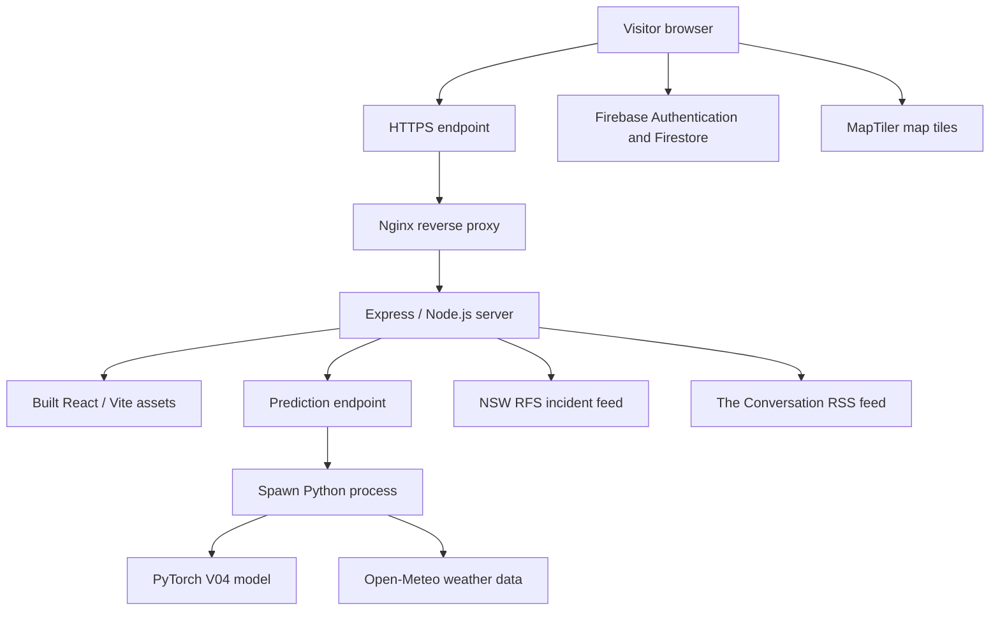

# FireScope AI — Deployment and Operations Guide

**Project:** FireScope AI (Bushfire AI)  
**Purpose:** ICT313 Assessment 3 technical documentation and future maintenance  
**Document status:** Configuration-based guide; VPS-specific commands require verification  
**Last reviewed:** 19 October 2026

> **Safety and scope:** This guide describes the known application architecture and a suggested deployment procedure. It does **not** claim that every command has been executed successfully on the production VPS. Never commit `.env` files, private keys, credentials, or service-account JSON files.

## 1. Deployment overview

FireScope AI is a web application with a React user interface, a Node.js/Express API, and a Python/PyTorch prediction pipeline. The publicly accessible deployment is hosted on a Linux virtual private server (VPS), with Nginx acting as the web-facing reverse proxy and PM2 used for Node.js process management.

**Public demonstration:** https://2026s2a2.winproject.com.au/  
**Source repository:** https://github.com/Ayu-gu/bushfire-ai

These addresses identify the project and are not instructions to modify the live environment.

### 1.1 Request flow



The browser renders the React interface. The Node.js backend serves the built frontend and handles API requests. For a prediction, the backend launches the Python inference script, which loads the trained model and retrieves weather inputs. Other integrations support maps, user accounts, incident information, and climate news.

## 2. Confirmed repository details

The following items were checked against the project's command output and prior source inspection.

| Item | Confirmed configuration |
|---|---|
| Frontend | React with Vite |
| Frontend project directory | `frontend-react/` |
| Backend entry point | `frontend-react/backend/server.js` |
| Start script | `npm start` runs `node backend/server.js` |
| Development script | `npm run dev` runs Vite |
| Production build script | `npm run build` runs Vite build |
| Lint script | `npm run lint` runs Oxlint |
| Preview script | `npm run preview` runs Vite preview |
| Default backend port | `3015`, overridable with `PORT` |
| Python bridge | Node.js `spawn()` calls `src/predict_api.py` |
| Model inference | Python/PyTorch, V04 production checkpoint |
| Static frontend hosting | Express `express.static(...)` |
| Process manager | PM2 (known deployment architecture; exact process name unverified) |
| Reverse proxy | Nginx (known deployment architecture; exact site configuration unverified) |

The repository scan did not identify a committed `Dockerfile`, PM2 ecosystem file, Nginx site configuration, or deployment automation script within the inspected depth. This does not prove such files are absent from the VPS.

## 3. Deployment prerequisites

A deployment operator needs:

- Access to an appropriately configured Linux VPS and the source repository.
- A compatible Node.js and npm installation.
- Python and a virtual environment containing the project's runtime dependencies.
- The model checkpoint and any required inference assets, available at the paths expected by the Python code.
- Environment variables and public integration configuration appropriate for the target environment.
- Nginx and PM2 if using the documented production architecture.
- Domain/DNS and HTTPS configuration managed by the hosting operator.

**Version caution:** Exact production versions of Node.js, Python, PyTorch, Nginx, and PM2 were not independently verified for this document. Record them from the live server before attempting a reproducible rebuild.

## 4. Application structure

```text
bushfire-ai/
├── frontend-react/
│   ├── src/                  # React application
│   ├── backend/
│   │   └── server.js        # Express application
│   ├── dist/                 # Generated by the Vite build
│   └── package.json
├── src/
│   ├── predict_api.py       # Node-to-Python entry point
│   └── predict_location.py  # Prediction and weather processing
├── models/
│   └── bushfire_model_v04.pth
└── docs/
    └── DEPLOYMENT.md
```

This is a simplified view. The repository also contains datasets, experimental scripts, other models, and documentation. Large or generated assets may be excluded from Git, so verify their availability separately.

## 5. Local preparation and verification

Run commands from the repository root unless otherwise specified. The following are **procedures to execute and record**, not assertions that the latest working tree passes them.

### 5.1 Check the working tree

```bash
git status --short
git branch --show-current
```

Review uncommitted changes before deploying. In particular, avoid overwriting active work or accidentally committing local secrets.

### 5.2 Install frontend/backend dependencies

```bash
cd frontend-react
npm install
```

For a locked, reproducible installation, `npm ci` is preferable **if** a compatible lockfile is committed and verified.

### 5.3 Run code quality and build checks

```bash
npm run lint
npm run build
```

Record the exit code and output. A successful build demonstrates that Vite generated deployable frontend assets; it does not establish that authentication, maps, predictions, and external services all work.

### 5.4 Start the application locally

```bash
npm start
```

By default, the backend listens on port `3015`, unless `PORT` is set. The browser-facing application should be tested only after the frontend build exists and required Python/model dependencies are configured.

### 5.5 Health endpoint

The Express backend exposes `GET /health`. For a local instance using the default port:

```bash
curl -i http://localhost:3015/health
```

Capture the actual response and status code as evidence. A successful health response confirms basic server reachability, **not** successful model inference or access to every external provider.

## 6. Python prediction runtime

The backend launches Python using `child_process.spawn()` and passes latitude and longitude to `src/predict_api.py`. That script uses the project inference pipeline and the V04 PyTorch checkpoint.

Before production use, verify:

1. The Python interpreter path used by `server.js` exists on the VPS.
2. Required packages are installed in the selected environment.
3. `src/predict_api.py` and related modules are readable by the application process.
4. `models/bushfire_model_v04.pth` is present and matches the expected model architecture.
5. External weather data is accessible from the VPS.
6. The model can produce a valid response for an intentionally chosen test coordinate.

**Important:** A relative Python executable path can behave differently depending on the service's working directory. Verify the PM2 `cwd` and the paths constructed in `server.js` before changing process settings.

Do not use an arbitrary model checkpoint from an untrusted source. Loading a PyTorch checkpoint can be unsafe if its origin is not trusted.

## 7. Environment and external integrations

FireScope AI uses several external services. Their setup and operational responsibilities are distinct.

| Integration | Purpose | Deployment consideration |
|---|---|---|
| Open-Meteo | Weather inputs for model inference | Network access, provider availability, timeouts |
| Firebase Authentication | Email/password and Google sign-in | Authorized domains and client configuration |
| Cloud Firestore | User history and saved locations | Rules, indexes, access permissions |
| MapTiler | Map tiles and map presentation | Public browser key restrictions and quota |
| NSW Rural Fire Service | Live NSW incident feed | Feed availability and geographic coverage |
| The Conversation Australia | Climate/environment articles | RSS availability and caching |
| Formspree | Contact form submission | Form endpoint and spam controls |

**Secrets and configuration:** Determine which variables are required by reading the actual source and deployment environment. Do not copy live secrets into documentation or a public Git repository. Browser-exposed configuration must be treated differently from server-side secrets; restrict keys through provider controls where supported.

## 8. Production build and serving model

The known application design uses a **single Express server** to serve both the compiled React application and API endpoints.

1. Build the React frontend using `npm run build` inside `frontend-react/`.
2. Verify the generated `frontend-react/dist/` directory exists.
3. Start `frontend-react/backend/server.js` with the correct environment and working directory.
4. Verify `GET /health`, static asset delivery, and at least one prediction request.
5. Configure Nginx to forward the public site's application requests to the active Express listener.
6. Use PM2 to supervise the Node.js process and retain logs.
7. Validate HTTPS and browser functionality from outside the VPS.

The precise Nginx server block, TLS certificate paths, PM2 application name, VPS filesystem location, and reload commands **must be obtained from the actual server**. They are intentionally not invented here.

## 9. Suggested production release checklist

| Check | Evidence to record | Status |
|---|---|---|
| Intended Git revision identified | Commit hash | Not recorded |
| Dependencies installed | Install command and exit status | Not recorded |
| Frontend build succeeds | Build output | Not recorded |
| Python environment resolves | Interpreter/version and dependency check | Not recorded |
| V04 model file available | Path and optional checksum | Not recorded |
| Backend health endpoint responds | HTTP response | Not recorded |
| Prediction API returns valid output | Redacted test response | Not recorded |
| Fire warnings and climate news load | Browser screenshot/API response | Not recorded |
| Firebase sign-in and saved data work | Manual test log | Not recorded |
| Map tiles display | Browser screenshot | Not recorded |
| Nginx HTTPS endpoint works | Browser or HTTP check | Not recorded |
| PM2 process remains healthy | Process status and logs | Not recorded |

“Not recorded” means this documentation does not yet contain evidence of the check. It does **not** mean the live application is failing.

## 10. Monitoring and troubleshooting

### 10.1 Frontend shows a blank page

Check whether the frontend was built, whether Express serves the correct `dist` directory, and whether browser developer tools show failed JavaScript requests. Verify Nginx routing and caching if applicable.

### 10.2 API health endpoint is unavailable

Check whether the Node.js process is running, whether `PORT` matches the reverse-proxy target, and whether the process has logged a startup error. Confirm local access before investigating external DNS or HTTPS.

### 10.3 Prediction fails but the dashboard loads

Inspect the backend's Python subprocess error output, interpreter path, model checkpoint path, dependency versions, and weather-provider connectivity. Avoid displaying raw server tracebacks to end users.

### 10.4 Map does not display

Check the browser console, MapTiler configuration, allowed origins, quota limits, and connectivity. A failed map provider does not necessarily indicate a model failure.

### 10.5 Authentication or saved locations fail

Review Firebase authorized domains, sign-in method configuration, Firestore security rules, and browser console messages. Never resolve permission errors by broadly opening database access.

### 10.6 Incident or news panels fail

External feeds may be delayed or unavailable. The backend applies caching and request timeouts to incident/news requests. Present these errors separately from AI prediction errors and avoid suggesting that missing incidents means there are no fires.

## 11. Reliability and security considerations

- **No emergency-service guarantee:** The platform is educational and is not a substitute for official warnings or emergency decisions.
- **Input validation:** Backend numeric coordinate parsing is known; geographic range validation should be reviewed and strengthened.
- **Subprocess lifecycle:** An explicit timeout for the Python subprocess has not been verified and should be considered.
- **Rate limiting:** Production request throttling and abuse protection should be independently verified.
- **Firestore rules:** Actual production rules have not been reviewed for this document.
- **Observability:** Structured logging, uptime alerts, and error monitoring are recommended but not verified as implemented.
- **Recovery:** A documented rollback procedure and recovery drill have not been verified.

These issues should also be cross-referenced in `SECURITY.md`, `LIMITATIONS.md`, and `ROADMAP.md`.

## 12. Rollback and change management

Before a production release, record the currently deployed commit, runtime versions, model checkpoint, and configuration dependencies. Preserve a recoverable previous build or revision. If a release causes failures, restore the last known-good version using the server's **verified** process-management procedure and confirm the health endpoint and user-facing features.

Do not use force pushes, destructive Git resets, blanket process kills, or unverified VPS commands as a routine deployment method. Review local changes and backup requirements first.

## 13. Evidence and verification boundaries

### Verified from repository output

- `npm run dev`, `npm run build`, `npm run lint`, `npm run preview`, and `npm start` script definitions.
- Express backend default port `3015`.
- Backend Python `spawn()` integration with `predict_api.py`.
- Express static file serving and listening behavior.
- Git commits dated 23 September 2026 (production preparation) and 8 October 2026 (documentation improvements).
- No dedicated deployment configuration file found in the limited repository scan.

### Known from application design, not independently audited on VPS

- Nginx reverse proxy and PM2 process supervision.
- Public deployment and its external integrations.
- V04 checkpoint inference pipeline.

### Still to collect

- Actual Linux distribution and runtime versions.
- Production PM2 process name, working directory, and start/restart procedure.
- Redacted Nginx routing configuration and TLS management method.
- Deployment logs, health check evidence, build output, and rollback verification.

## 14. Related documentation

- [`ARCHITECTURE.md`](ARCHITECTURE.md) — application components and request flow.
- [`MACHINE_LEARNING.md`](MACHINE_LEARNING.md) — model architecture and inference inputs.
- [`DATABASE_DESIGN.md`](DATABASE_DESIGN.md) — Firebase data model.
- [`TESTING.md`](TESTING.md) — validation plan and evidence status.
- [`SECURITY.md`](SECURITY.md) — security analysis and controls.
- [`LIMITATIONS.md`](LIMITATIONS.md) — scope and known constraints.

---

**Documentation principle:** A reliable deployment guide separates verified source configuration, known architecture, recommended operating procedure, and production facts that still require direct confirmation.
