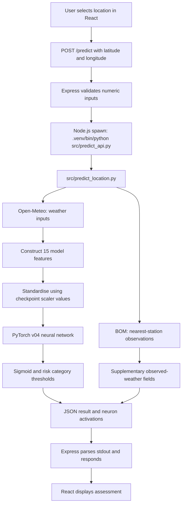

# FireScope AI — Machine Learning Design and Inference

**Project:** FireScope AI (Bushfire AI)  
**Document type:** Machine Learning Technical Documentation  
**Scope:** Production prediction path verified from local source excerpts on 19 October 2026

## 1. Purpose and evidence boundary

This document describes the model and prediction logic called by the application's inspected backend code. It separates **verified implementation details** from historical experiments and evaluation claims that have not yet been checked. The production VPS configuration and model artifact were not independently inspected for this document.

The application is an **educational risk-awareness tool**, not an official bushfire danger rating, emergency alert, or operational forecasting system.

## 2. Production inference path

The inspected implementation follows this sequence:



**Code references:** `frontend-react/backend/server.js`, `src/predict_api.py`, `src/predict_location.py`.

The backend starts a new Python child process for each request; the Python component is **not** an independently deployed HTTP API in this implementation. `predict_api.py` reads two command-line arguments, calls `predict_location(latitude, longitude)`, and prints JSON to standard output.

## 3. Production model selection

The inspected prediction module defines:

```python
MODEL_PATH = "models/bushfire_model_v04.pth"
```

It loads this checkpoint with PyTorch, restores `checkpoint["model_state_dict"]`, and switches to `model.eval()`. The checkpoint also supplies `scaler_mean` and `scaler_scale`. This establishes **v04 as the model selected by the inspected local prediction path**; it does not independently establish which artifact is currently deployed on the remote server.

The model is evaluated on Apple's MPS device if available; otherwise it uses the CPU. On a typical Linux VPS without MPS, this code selects CPU.

## 4. Neural network architecture

The `BushfireModel` class defines a fully connected feed-forward neural network:

| Stage | Operation | Output dimension |
|---|---|---:|
| Input | Environmental feature vector | 15 |
| Hidden layer 1 | Linear(15, 32) + ReLU | 32 |
| Hidden layer 2 | Linear(32, 16) + ReLU | 16 |
| Hidden layer 3 | Linear(16, 8) + ReLU | 8 |
| Output | Linear(8, 1) | 1 logit |
| Post-processing | Sigmoid | 1 value in (0, 1) |


The final sigmoid is applied **during inference**, after the network's last linear layer; it is not defined as a layer inside `nn.Sequential`.

The returned value is a **model-derived probability-like score**. It must not be described as a calibrated real-world probability of a bushfire without calibration and validation evidence.

## 5. Environmental input features

The production inference code constructs the following **15 features, in this exact order**:

| Position | Feature | Derivation in inspected code |
|---:|---|---|
| 1 | Month | Current local execution date, 1–12 |
| 2 | Day of year | Current execution date, 1–366 |
| 3 | Season | Encoded as summer=0, autumn=1, winter=2, spring=3 |
| 4 | Maximum temperature | Final daily `temperature_2m_max` value |
| 5 | Minimum temperature | Final daily `temperature_2m_min` value |
| 6 | Average humidity | Mean of available values in last 24 hourly relative-humidity entries |
| 7 | Maximum wind speed | Final daily `wind_speed_10m_max` value |
| 8 | Rain today | Final daily precipitation entry |
| 9 | Rain in previous 7 days | Sum of `rainfall[-8:-1]`, excluding final entry |
| 10 | Rain in previous 30 days | Sum of `rainfall[:-1]`, excluding final entry |
| 11 | Days since rain | Count backwards through earlier rainfall entries until a day with >=1 mm |
| 12 | Temperature–humidity index | `max_temp * (100 - avg_humidity) / 100` |
| 13 | Temperature–wind index | `max_temp * max_wind` |
| 14 | Dryness index | `(days_since_rain + 1) / (rain_last_30_days + 1)` |
| 15 | Vapour pressure deficit (VPD) | Saturation vapour pressure at maximum temperature minus estimated actual vapour pressure |

**Important:** The fifteenth input is **VPD**, not a humidity–wind index. The feature list here reflects the inspected production source and should take precedence over any older README description.

### 5.1 VPD calculation

The code calculates saturation vapour pressure as:

`svp = 0.6108 × exp((17.27 × max_temp) / (max_temp + 237.3))`

It then estimates actual vapour pressure as `svp × (avg_humidity / 100)` and returns their difference. The computation combines maximum temperature and an average humidity value; it is an engineered approximation, not a direct sensor measurement of VPD.

### 5.2 Feature scaling

Before inference, the 15-value NumPy vector is standardised elementwise:

`scaled_input = (input_data - scaler_mean) / scaler_scale`

The scaling arrays are loaded from the v04 checkpoint. This is important: inference must use the same feature order and compatible scaling values as the trained model.

## 6. Weather sources and their roles

### 6.1 Open-Meteo — model inputs

The prediction module requests Open-Meteo's forecast API with geographic coordinates and the following data:

- Current temperature, relative humidity, and wind speed.
- Daily maximum/minimum temperature, precipitation sum, and maximum wind speed.
- Hourly relative humidity.
- `past_days=30`, `forecast_days=1`, and `timezone=Australia/Sydney`.
- HTTP request timeout of **30 seconds**.

The model's feature vector is constructed from the daily/hourly data and the execution date. The returned current Open-Meteo values are read by the code but are not directly inserted into the 15-element model vector.

The precise meaning of the **last daily entry** depends on the API response window. The source should be checked before interpreting that entry as a completed historical observation rather than a forecast or partial-day value.

### 6.2 Bureau of Meteorology — supplementary observations

`find_nearest_station(latitude, longitude)` from `src/fetch_bom_observations.py` supplies nearest-station observations. The response includes, where available:

- `current_temp`, `current_humidity`, and `current_wind`;
- `weather_source`, `weather_station`, `weather_station_distance_km`;
- `weather_observation_time`.

These BOM fields are **returned for context**; the inspected 15-feature vector does not use them as model inputs. The exact station selection and fallback behaviour require a separate review of `fetch_bom_observations.py`.

## 7. Inference and risk classification

The model runs with `torch.no_grad()` and exposes the hidden-layer activations for the application's neural-network visualisation. The output logit is converted using `torch.sigmoid`, then multiplied by 100:

`risk_score = sigmoid(logit) × 100`

The code applies these **application-defined** thresholds:

| Score | Display label |
|---|---|
| Below 30 | `LOW` |
| 30 to below 50 | `MODERATE` |
| 50 to below 70 | `HIGH` |
| 70 or above | `VERY HIGH` |

These categories are **not equivalent to the Australian Fire Danger Rating System** and must not be presented as official emergency-service classifications. No evidence has yet been supplied showing that these particular thresholds were statistically optimised or externally validated.

The returned JSON includes the location, risk score, risk label, selected environmental fields, supplementary BOM information, and the following activation arrays: `input`, `layer1`, `layer2`, `layer3`, and `output`.

## 8. Error handling and operational behaviour

From the inspected Express and Python code:

- Express rejects missing or non-numeric coordinates with HTTP 400.
- Express launches the Python process and collects standard output and standard error.
- A non-zero Python exit code produces HTTP 500 (`Prediction failed`).
- Output that cannot be parsed as JSON produces HTTP 500 (`Invalid prediction response`).
- The React application displays an error if the request fails.
- The React code uses a request identifier to avoid showing a stale result after a location change.

**Areas not established by this inspection:** latitude/longitude range checks, a Python-process execution timeout, and an explicit child-process `error` event handler. These should be assessed during security and reliability testing rather than assumed to be present.

## 9. Training and research history

The repository file inventory shows that the project contains substantially more experimental work than the selected v04 inference path:

| Area | Evidence in repository inventory | Interpretation |
|---|---|---|
| Earlier neural network versions | `train_model_v03.py` through `train_model_v07.py` | Iterative training scripts |
| Stage 11 architecture experiments | `models/stage11/` with several model sizes and `experiment_results.csv` | Saved architecture comparison artifacts |
| Vegetation-related experiments | Stage 12b, 12c, 12d, and 12g model artifacts | Alternative feature-representation investigations |
| Random Forest experiments | `train_random_forest_stage13a.py`, `train_random_forest_tournament_stage13b.py` | Alternative model family |
| Neural network tournament | `train_final_nn_tournament_stage14a.py` and `models/stage14a/results.json` | Later architecture comparison artifacts |
| Temporal model | `train_temporal_lstm_stage15a.py` and `models/stage15a/temporal_lstm.pth` | Temporal experiment |
| Dataset engineering and audits | Dataset build, enrichment, spatial validation, vegetation provenance and event-aware split scripts | Dataset preparation and quality-control work |

**Evidence boundary:** Filenames and artifact presence establish that these scripts and saved outputs exist. They do **not** establish successful runs, specific performance, or adoption in production. The v04 model remains the one referenced by the inspected prediction module.

## 10. Evaluation: evidence still required

No verified numeric evaluation results were provided for this document. Therefore, **accuracy, precision, recall, F1, ROC-AUC, confusion-matrix counts, calibration, and test-set performance are not reported as facts here**.

Before adding model-performance claims, inspect the appropriate training/evaluation scripts and saved results to establish:

1. Which dataset and label definition were used for the **v04** model.
2. Training, validation and test splitting methods, including any temporal or spatial separation.
3. Class balance and potential leakage or duplication between splits.
4. Evaluation metrics on genuinely held-out data.
5. How threshold selection affects false positives and false negatives.
6. Whether the sigmoid output is calibrated and whether performance generalises to new locations and periods.

A results table should be completed only from reproducible evidence:

| Metric | v04 result | Evidence status |
|---|---|---|
| Accuracy | Not verified | Requires evaluation artifact |
| Precision | Not verified | Requires evaluation artifact |
| Recall | Not verified | Requires evaluation artifact |
| F1 score | Not verified | Requires evaluation artifact |
| ROC-AUC | Not verified | Requires evaluation artifact |
| Confusion matrix | Not verified | Requires evaluation artifact |
| Probability calibration | Not verified | Requires calibration assessment |

## 11. Known limitations and risks

- **Research-to-production gap:** Newer experimental artifacts are not automatically reflected in the deployed inference path.
- **Geographic generalisation:** No evidence in this document establishes reliable performance for every Australian region.
- **Weather source dependency:** Network outages, missing fields, unexpected data windows, or API changes can interrupt inference.
- **Missing-data assumptions:** The code treats missing rainfall entries as zero during sums; the last-24-hour humidity mean requires at least one valid value.
- **Time conventions:** `datetime.now()` supplies date-derived features, while the weather request specifies `Australia/Sydney`; consistency depends on server time settings and API data interpretation.
- **Score interpretation:** A sigmoid-derived percentage is not necessarily a calibrated probability of an actual fire event.
- **Official warning separation:** A model risk category is not an official fire danger rating or an incident warning.
- **Resource management:** Spawning Python for every request has performance and concurrency implications.
- **Model loading:** The code uses `torch.load(..., weights_only=False)`; checkpoint files should be treated as trusted artifacts and not loaded from untrusted sources.

These are identified engineering risks, not assertions that a specific production incident has occurred.

## 12. Reproducibility and future verification

To make the ML evidence reproducible, future documentation should record the dataset version, target definition, split methodology, random seeds, training environment, model selection rationale, exact dependency versions, and evaluation outputs. The final production model and scaler should be tied to an identifiable checkpoint and source revision.

The next useful inspection is the **v04 training and evaluation code** (`src/train_model_v04.py`, `src/evaluate_model_v04.py`, and related files), followed by any recorded metrics. Do not overwrite or retrain production artifacts merely to produce documentation.

## 13. Related documents

- [Project Overview](PROJECT_OVERVIEW.md)
- [Software Requirements](REQUIREMENTS.md)
- [System Architecture](ARCHITECTURE.md)
- [Testing and Validation](TESTING.md)
- [Security](SECURITY.md)
- [Limitations](LIMITATIONS.md)
- [Roadmap](ROADMAP.md)

## 14. Conclusion

The inspected FireScope AI prediction path uses a 15-input, three-hidden-layer PyTorch neural network stored as `bushfire_model_v04.pth`. It combines engineered Open-Meteo environmental features with checkpoint-based scaling, then converts a model logit into an application-defined risk score and category. BOM observations supplement the displayed context without entering the inspected model input vector.

The repository also contains a broader experimental programme. Its performance claims and the deployment state should be documented only after the relevant results and runtime configuration have been verified.
