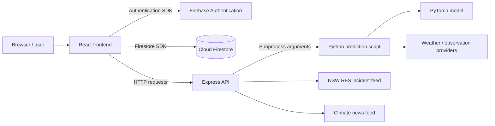

# FireScope AI — Security and Privacy

**Project:** FireScope AI (Bushfire AI)  
**Document:** Security assessment and recommended controls  
**Assessment context:** ICT313 A3 Project Solution  
**Last reviewed:** 19 October 2026

> **Evidence boundary:** This document distinguishes repository-observed behaviour from unverified production settings. It is not a penetration-test report or a certification of security. No live server, Firebase console, Firestorm rules, or secrets were inspected during preparation.

## 1. Purpose and scope

FireScope AI is a web application that combines a React frontend, an Express backend, a Python/PyTorch prediction process, external weather and incident feeds, Firebase Authentication, and Cloud Firestore. This document describes relevant security boundaries, current evidence, potential weaknesses, privacy considerations, and a prioritised improvement plan.

The review considers:

- Browser and frontend code.
- Authentication and access to per-user Firestore documents.
- Public Express endpoints and the Python prediction subprocess.
- External API dependencies and operational infrastructure.
- Handling of location and account-associated data.

It does **not** establish that production configurations are secure. Firebase rules, HTTPS configuration, Nginx settings, VPS firewall, PM2 permissions, provider console settings, and incident response procedures remain to be independently checked.

## 2. System trust boundaries



**Key distinction:** Firebase client-side use of a signed-in user's UID to construct a Firestore path is a UI convention, **not** an access-control guarantee. Firestore Security Rules must independently enforce the access policy on the server side.

## 3. Evidence observed in the repository

The following items were confirmed from command output supplied for this assessment:

| Area | Evidence | Interpretation |
|---|---|---|
| Authentication | `AuthModal.jsx` imports Firebase email/password registration, sign-in, Google popup, email verification, and password reset APIs | Account-related functionality is implemented; policy enforcement and end-to-end success are not independently verified |
| Session awareness | `Header.jsx`, `History.jsx`, `SavedLocations.jsx`, and `Settings.jsx` use Firebase authentication state listeners | UI responds to sign-in state; not a substitute for database rules |
| Per-user data paths | Firestore collections use `users/{uid}/predictionHistory` and `users/{uid}/savedLocations` | Logical separation in application code; actual isolation is unverified |
| Data operations | Frontend uses `addDoc`, `onSnapshot`, and `deleteDoc` | Client reads and writes must be constrained by Firestore rules |
| Express middleware | `app.use(cors())` and `app.use(express.json())` | CORS and JSON parsing are enabled; explicit origin restrictions and request-size policy were not observed in supplied snippets |
| Backend port | `process.env.PORT || 3015` | Port is configurable; this is not evidence of firewall restrictions |
| Python integration | Express launches `src/predict_api.py` using `spawn()` | Separate process boundary; input validation, timeouts, and resource limits matter |
| Environment files | `git ls-files` search returned no matching `.env` or common credential filenames | No matching tracked filenames were found; this does not prove secrets have never been committed or exposed |
| Firebase rules | No `firestore.rules`, `firebase.json`, or `.firebaserc` found in inspected repository depth | Firestore rules could exist in Firebase Console; their contents and enforcement remain unknown |

### Evidence limitations

The inspection searched only the local repository and selected code patterns. It did not execute security tests or inspect live Firebase settings. A missing security-related filename does not prove a setting is absent in production. Similarly, the presence of an SDK method does not prove that all user flows work correctly.

## 4. Authentication

The application includes Firebase Authentication flows for email/password and Google sign-in. It also references email verification, password reset, and sign-out functions.

**Verified implementation evidence:** authentication-related SDK calls are present in the React source. **Not verified:** whether email verification is required before access to protected functions, password policy configuration, provider restrictions, session persistence settings, multi-factor authentication, or protection against account enumeration.

### Recommended checks

1. Confirm enabled sign-in providers and authorised domains in Firebase Console.
2. Test registration, login, logout, password reset, and email-verification behaviour with dedicated test accounts.
3. Determine whether an unverified email account is intentionally permitted to use FireScope AI; document the actual policy.
4. Ensure account error messages do not disclose unnecessary personal information.
5. Use Firebase-supported authentication and session-management features rather than implementing custom password storage.

## 5. Firestore authorisation — priority verification

Frontend source uses these user-specific collections:

```text
users/{uid}/predictionHistory/{recordId}
users/{uid}/savedLocations/{locationId}
```

The application derives the UID from the authenticated user before reading and writing documents. However, an attacker can bypass frontend navigation and directly call Firestore APIs. **Only server-enforced Firestore Security Rules can prevent one user from accessing another user's records.**

A *candidate policy pattern* for review is shown below. **This is not a claim about deployed rules; do not paste it into production without checking all required collection paths and workflows.**

```javascript
rules_version = '2';
service cloud.firestore {
  match /databases/{database}/documents {
    match /users/{userId}/predictionHistory/{recordId} {
      allow read, write: if request.auth != null
        && request.auth.uid == userId;
    }

    match /users/{userId}/savedLocations/{locationId} {
      allow read, write: if request.auth != null
        && request.auth.uid == userId;
    }

    match /{document=**} {
      allow read, write: if false;
    }
  }
}
```

This example enforces a UID match but **does not** validate field types, coordinate ranges, document sizes, or ownership fields. Production rules should be reviewed for least privilege and schema constraints. The catch-all deny rule may block other legitimate collections, so inventory all Firestore access before changing rules.

### Required rule tests

| Test | Expected outcome | Current status |
|---|---|---|
| Signed-out client reads a user's history | Denied | Not verified |
| User A reads User A history | Allowed, if intended | Not verified |
| User A reads User B history | Denied | Not verified |
| User A writes to User B saved locations | Denied | Not verified |
| Invalid or oversized record fields | Rejected under validated rules | Not verified |
| User deletes own saved location | Allowed, if intended | Not verified |

Use the Firebase Rules Playground or Emulator Suite and record screenshots or test output for the A3 evidence appendix.

## 6. Express API and input handling

The backend exposes a prediction route and endpoints for fire incidents and climate news. The observed middleware includes `cors()` and `express.json()`.

### Risks to assess

**Cross-origin policy.** Calling `cors()` without explicit options generally allows broad cross-origin access. CORS is a browser access policy, not authentication or rate limiting. Review whether the public API is intended for unrestricted use. Where appropriate, define permitted origins and methods.

**Input validation.** The prediction endpoint receives `latitude` and `longitude`. Earlier source review confirmed numeric validation, but did not establish explicit geographic bounds. Validate finite numbers and enforce latitude from -90 to 90 and longitude from -180 to 180 before invoking Python. Consider restricting request body size and rejecting unexpected fields.

**Abuse and availability.** Each prediction may start a Python process and load or use ML resources. Without request throttling or concurrency limits, repeated requests could exhaust CPU or memory. Apply a suitable rate limit, concurrency controls, monitoring, and subprocess timeout. Exact settings should reflect measured workload.

**Error handling.** Return helpful but non-sensitive error messages. Avoid exposing stack traces, filesystem paths, provider tokens, or environment values to clients. Keep detailed diagnostics in access-controlled server logs.

**HTTP hardening.** Review response headers, HTTPS enforcement, proxy trust settings, and any authentication requirements for endpoints. A package named `helmet` or `express-rate-limit` was not established by the inspected output; do not claim those controls are deployed.

## 7. Python subprocess and model safety

Express launches a Python prediction script using Node's `spawn()`. This is preferable to building a shell command from raw user input when used with a fixed executable and argument array; however, safe invocation depends on the actual code and validation.

Recommended controls:

- Use a fixed executable/script path and argument array; do not pass user input to a shell.
- Validate and bound coordinates before process creation.
- Set a maximum runtime and terminate timed-out child processes.
- Limit concurrent predictions and monitor memory use.
- Restrict filesystem permissions for code, model checkpoints, and runtime credentials.
- Treat model checkpoint files as trusted artifacts. PyTorch deserialisation can be dangerous with untrusted files; do not accept user-uploaded checkpoints for loading.
- Ensure external weather-provider errors produce controlled failures rather than misleading predictions.

No live stress test, timeout test, or dependency vulnerability scan has yet been supplied as evidence.

## 8. External data and supply-chain risks

FireScope AI relies on third-party services for mapping, weather, incident information, climate news, authentication, and database storage.

| Dependency | Main consideration |
|---|---|
| Firebase Authentication / Firestore | Provider configuration, rules, quotas, account data access |
| MapTiler | API-key restrictions, usage quotas, public client key handling |
| Open-Meteo and supplementary weather sources | Availability, latency, missing values, data freshness |
| NSW RFS incident feed | Feed validity, update timing, geographic coverage, stale information |
| Climate news RSS | External content availability and safe rendering |
| Node/Python dependencies | Known vulnerabilities, version pinning, dependency provenance |

The NSW RFS incident feed is not a comprehensive national alert system. FireScope AI must not present its own model output as an official warning.

### Recommended dependency checks

Run vulnerability scans and review results before reporting a clean bill of health. For example, from the React project directory, `npm audit` may identify known npm dependency advisories. Python dependencies should be reviewed with an appropriate vulnerability scanner. These checks have **not** been recorded as completed in this document.

## 9. Secrets and configuration

The Git search did not return tracked `.env` or common credential filenames. This is encouraging but limited evidence.

Security practices to verify:

- Keep server-only secrets outside source control.
- Do not commit Firebase service-account private keys.
- Distinguish public Firebase web configuration from privileged service credentials; public frontend configuration does not replace Firestore rules.
- Apply domain/API restrictions to browser-exposed keys when the provider supports them.
- Rotate a secret promptly if exposure is suspected.
- Review Git history and deployed logs if investigating a suspected leak.
- Keep production environment variables readable only by authorised processes/operators.

Never paste secret values into an academic report or public GitHub repository.

## 10. Privacy and data lifecycle

User-linked records may include location coordinates, user-entered location names, risk results, weather-derived values, and timestamps. Even when they are not exact home addresses, location histories can be sensitive.

Recommended privacy practices:

1. Explain what is saved when a signed-in user makes a prediction or bookmarks a location.
2. Collect only fields required for application functionality.
3. Confirm whether records can be deleted individually and whether full-account data deletion is supported; do not claim automatic deletion without implementation evidence.
4. Restrict administrative access to stored data.
5. Define a retention policy and a process for responding to user data requests.
6. Avoid collecting unnecessary precise location data in analytics or logs.
7. Review any applicable Australian privacy obligations based on the project's actual operator and use case.

The repository evidence confirms delete operations for individual history and saved-location records. It does not establish a complete account-deletion or retention workflow.

## 11. Hosting and transport security

The project is deployed behind Nginx with a Node/Express application managed by PM2, based on prior project deployment context. The actual production server configuration was **not inspected**.

Before declaring deployment secure, verify:

- HTTPS certificate validity and HTTP-to-HTTPS redirect.
- Nginx proxy and security-header configuration.
- Firewall rules; ensure internal Node port 3015 is not unnecessarily exposed publicly.
- SSH key-based access, operator permissions, and server updates.
- PM2 process user, restart policy, logs, and resource limits.
- Backup strategy and restoration procedure for critical configuration.
- Monitoring for abnormal traffic and provider/API failures.

Document the checks with redacted configuration snippets or screenshots, not private keys or access tokens.

## 12. Prioritised security improvement register

| Priority | Item | Reason | Status |
|---|---|---|---|
| Critical to verify | Inspect and test deployed Firestore Security Rules | Prevent cross-user access to saved data | Not verified |
| High | Enforce geographic coordinate bounds and body-size limits | Reject malformed or abusive prediction requests | Not verified |
| High | Add prediction rate limiting and subprocess timeout | Protect availability and compute resources | Not verified |
| High | Confirm HTTPS and internal-port exposure on VPS | Protect transport and reduce attack surface | Not verified |
| Medium | Review CORS policy | Align cross-origin behaviour with intended public API | Review required |
| Medium | Scan Node/Python dependencies | Identify known dependency vulnerabilities | Not run for this report |
| Medium | Verify API key restrictions and secret-handling practices | Reduce credential misuse | Not verified |
| Medium | Test sign-up, reset, verification, and sign-out flows | Validate account lifecycle | Test evidence pending |
| Medium | Document retention and deletion procedures | Improve privacy transparency | Incomplete |
| Medium | Add monitoring, backup, and incident-response procedures | Improve operational resilience | Not verified |

These are recommended checks and changes, not claims that a vulnerability has been exploited.

## 13. Suggested security test record

For each test, capture: **test ID, date, environment, tester, input, expected outcome, observed outcome, pass/fail status, and evidence link**.

Suggested tests:

- SEC-01: unauthenticated Firestore read denied.
- SEC-02: cross-account history read denied.
- SEC-03: cross-account saved-location write denied.
- SEC-04: invalid coordinates rejected by `/predict`.
- SEC-05: oversized JSON request handled safely.
- SEC-06: repeated prediction requests controlled.
- SEC-07: provider timeout yields a safe error.
- SEC-08: public site redirects to HTTPS.
- SEC-09: privileged credentials absent from published repository.
- SEC-10: logout prevents access to account-specific UI data.

**Current result:** These tests are **proposed**, not recorded as executed or passed.

## 14. Security and safety disclaimer

FireScope AI is an educational bushfire-risk information tool. Its model score is not a calibrated probability of a fire occurring, an official Australian Fire Danger Rating, or a substitute for emergency services advice. External incident feeds may be delayed or incomplete. Users should rely on the relevant emergency authority for active warnings and urgent decisions.

## 15. Conclusion

The repository demonstrates a meaningful security foundation: established Firebase authentication APIs, per-user data organisation, and separation of browser, backend, and Python inference components. However, the most important authorisation control—**deployed Firestore Security Rules**—has not been verified. API hardening, resource limits, deployment security, privacy processes, and security testing also require evidence before stronger assurances can be made.

This assessment is intended to make those boundaries explicit and provide an actionable path from a functioning student prototype toward a more robust service.
